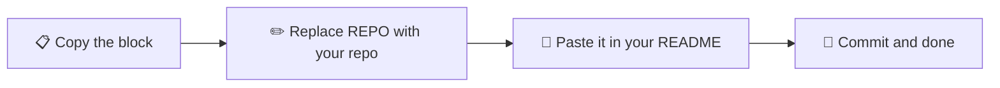
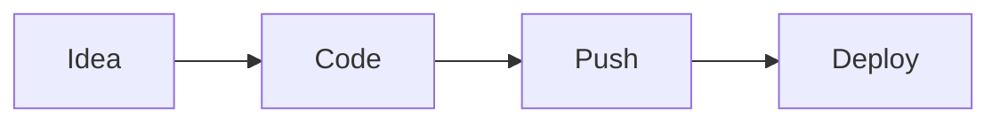

<!-- Header -->
<div align="center">

# 🧰 GitHub README Cheatsheet

**Everything you need to make your README look professional: copy, paste, done.**

<!-- Status badges -->
[](https://github.com/ag-hp/github-readme-cheatsheet/actions/workflows/blank.yml)


[](https://deepwiki.com/ag-hp/github-readme-cheatsheet)

<!-- Menu -->
[🏷️ Badges](#badges) · [📚 Repositories](#repos) · [🎨 Visual elements](#visual) · [⚖️ Licenses](#licenses) · [📁 Structure](#structure)

</div>

---

<!-- Index -->
## ✨ What you will find here

| | Section | What it is for |
|:-:|---|---|
| 🏷️ | **Badges** | Deploy buttons (Vercel, Render, Railway...) and repo status badges |
| 📚 | **Repositories** | My projects, with links to GitHub and to their AI-generated docs |
| 🎨 | **Visual elements** | Alerts, HTML centering, light/dark logo, collapsible sections and diagrams |
| ⚖️ | **Licenses** | Which one to pick and how to add it to your repo |

<!-- Flow diagram -->


> [!TIP]
> In every code block, replace `REPO` with your repository name and `ag-hp` with your username.

---

<!-- Badges section -->
<a id="badges"></a>

## 🏷️ Badges

### 🚀 Deploy buttons

<!-- Deploy buttons preview -->
<div align="center">


</div>

<!-- Copyable code -->
<details>
<summary>📋 <b>Copy the code (Markdown)</b></summary>

```markdown
[](https://vercel.com/new/clone?repository-url=https://github.com/ag-hp/REPO)
[](https://railway.com/new/template?template=YOUR_TEMPLATE_URL)
[](https://render.com/deploy?repo=https://github.com/ag-hp/REPO)
[](https://cloud.digitalocean.com/apps/new?repo=https://github.com/ag-hp/REPO/tree/main)
[](https://deploy.workers.cloudflare.com/?url=https://github.com/ag-hp/REPO)
[](https://codesandbox.io/p/github/ag-hp/REPO)
[](https://stackblitz.com/github/ag-hp/REPO)
[](https://glitch.com/edit/#!/import/github/ag-hp/REPO)
[](https://console.firebase.google.com/)
[](https://replit.com/github/ag-hp/REPO)
[](https://deepwiki.com/ag-hp/REPO)
```

</details>

<details>
<summary>🧱 <b>Copy the code (HTML)</b></summary>

```html
<!-- Vercel button in HTML -->
<a href="https://vercel.com/new/clone?repository-url=https://github.com/ag-hp/REPO" target="_blank">
  
</a>
```

</details>

> [!NOTE]
> - **Railway** needs a template URL created from its dashboard.
> - **Firebase** has no one-click deploy from GitHub: the button just opens the console.
> - GitHub ignores `target="_blank"` in READMEs, so links open in the same tab.

### 📊 Repository status badges


<details>
<summary>📋 <b>Copy the code</b></summary>

```markdown


```

</details>

---

<!-- Repositories section -->
<a id="repos"></a>

## 📚 Repositories

<!-- Projects table -->
| Project | Description | GitHub | AI docs |
|---|---|:-:|:-:|
| 🚇 **TRANZIT** | Android app with alerts for Metro, Cercanías and CRTM incidents | [View](https://github.com/ag-hp/tranzit) | [DeepWiki](https://deepwiki.com/ag-hp/tranzit) |
| 🌌 **Cosmos Web** | Astronomy website built with HTML (index, content and contact pages) | [View](https://github.com/ag-hp/prac1html_XXXY) | [DeepWiki](https://deepwiki.com/ag-hp/prac1html_XXXY) |
| 👤 **GitHub Profile** | Profile README with header, snake, badges and tech stack | [View](https://github.com/ag-hp/ag-hp) | [DeepWiki](https://deepwiki.com/ag-hp/ag-hp) |
| 🇬🇧 **English** | Unit 1 English notes written in Markdown | [View](https://github.com/ag-hp/english) | [DeepWiki](https://deepwiki.com/ag-hp/english) |

> [!TIP]
> **DeepWiki** generates AI documentation for any public repo: just change `github.com` to `deepwiki.com` in the URL.

---

<!-- Visual elements section -->
<a id="visual"></a>

## 🎨 Visual elements for your README

<!-- Alerts -->
### 🔔 GitHub alerts

> [!NOTE]
> Useful information worth reading.

> [!TIP]
> A tip to do something better or more easily.

> [!IMPORTANT]
> What you absolutely need to know.

> [!WARNING]
> Something that can cause problems if ignored.

> [!CAUTION]
> Something that can have serious consequences.

<details>
<summary>📋 <b>Copy the code</b></summary>

```markdown
> [!NOTE]
> Here is a note

> [!TIP]
> Here is a tip

> [!IMPORTANT]
> Here is something important

> [!WARNING]
> Here is a warning

> [!CAUTION]
> Here is a caution
```

</details>

### 🎯 Center images or titles with HTML

```html
<!-- Centered block -->
<div align="center">
  
  <h1>Centered title</h1>
  <p>Short project description</p>
</div>
```

### 🌗 Logo that switches between dark and light mode

```html
<!-- Dark/light logo -->
<picture>
  <source media="(prefers-color-scheme: dark)" srcset="dark-image-url">
  
</picture>
```

### 📂 Collapsible sections

```html
<!-- Collapsible section -->
<details>
<summary>Click to see more</summary>

Hidden content goes here.

</details>
```

### ✅ Task lists and diagrams

````markdown
- [x] Completed task
- [ ] Pending task


````

### 📝 Recommended README structure

1. Title and logo
2. Badges
3. Short description
4. Screenshot or demo
5. Features
6. Installation and usage
7. Tech stack
8. How to contribute
9. License and contact

> [!CAUTION]
> Never upload passwords, tokens, API keys or `.env` files. If you already did, change the keys even after deleting the file: it stays in the commit history.

---

<!-- Licenses section -->
<a id="licenses"></a>

## ⚖️ Licenses

> [!WARNING]
> If you add no license, all rights are reserved: nobody can legally copy, modify or reuse your code, even if the repo is public.

| If you want... | Pick | Badge |
|---|---|---|
| Something simple that works everywhere | **MIT** |  |
| Patent protection and commercial use | **Apache 2.0** |  |
| Nobody can close your code (copyleft) | **GNU GPLv3** |  |
| To give up all your rights | **Unlicense / CC0** |  |

> [!TIP]
> If you are starting a personal project or a small library, **MIT** is the standard and safest option to encourage collaboration.

**How to add a license:** in your repo click **Add file → Create new file**, name it `LICENSE` and pick a template with **Choose a license template**. You can compare options at [choosealicense.com](https://choosealicense.com).

---

<!-- Structure section -->
<a id="structure"></a>

## 📁 Repository structure

```text
github-readme-cheatsheet/
├── .github/
│   └── workflows/
│       └── blank.yml      # CI workflow
├── LICENSE                # MIT license
└── README.md              # Readme
```

---

<div align="center">

<!-- Footer -->
## 📄 License

Distributed under the **MIT** license. See the [LICENSE](LICENSE) file for more information.

Made with ☕ by [@ag-hp](https://github.com/ag-hp)

</div>
